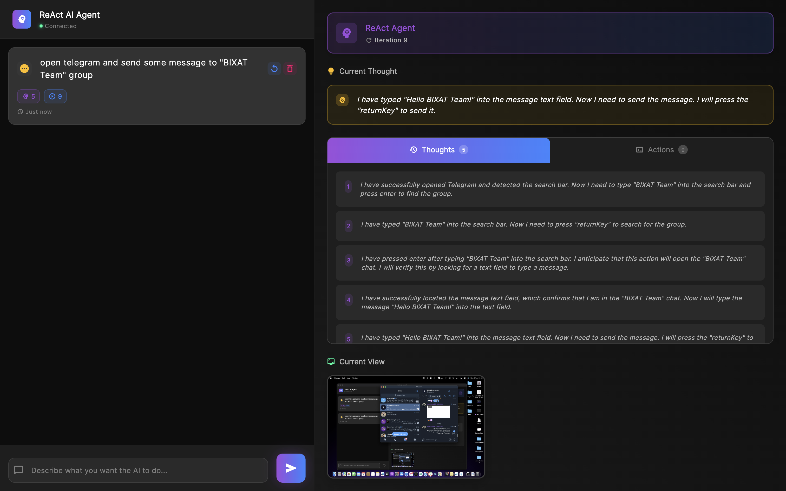
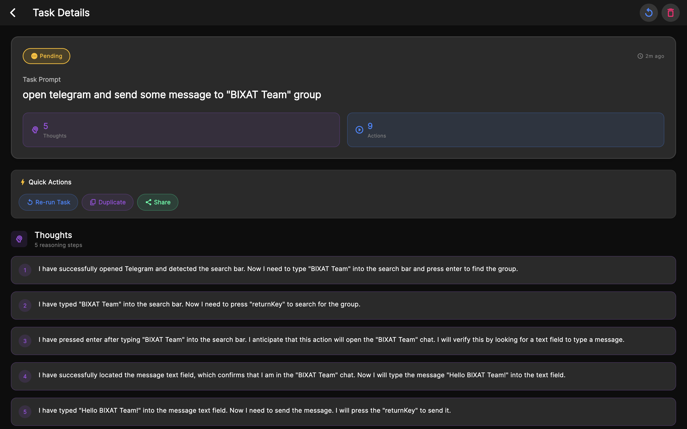
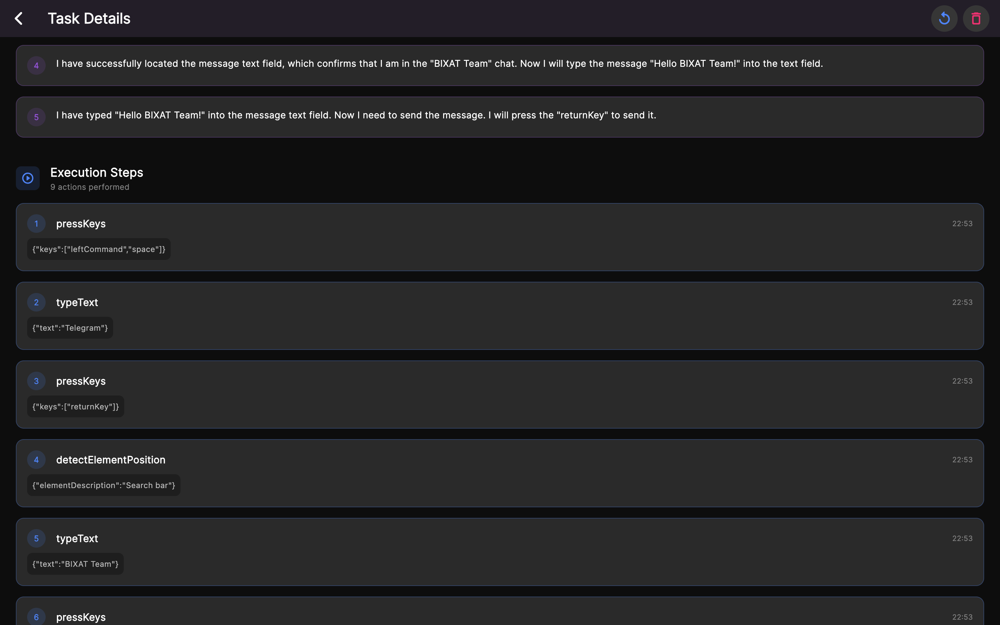

# NextDesk

**NextDesk** is an intelligent desktop automation application powered by **LLMs via OpenRouter** (using advanced models like Google's Gemini 3.0) that uses the **ReAct (Reasoning + Acting)** framework to understand and execute complex computer tasks through natural language commands.

> ⚠️ **UNDER DEVELOPMENT**
> This project is currently in development and **not ready for production use**.
> The vision-based element detection tool (`detectElementPosition`) is experimental.
> We recommend using keyboard shortcuts (`pressKeys`) and the `getShortcuts` tool for more reliable automation.

## 🌟 Overview

This Flutter desktop application combines AI reasoning with keyboard automation and input control to automate desktop tasks. Simply describe what you want to do in natural language (e.g., "open Chrome and search for Flutter documentation"), and the AI agent will break it down into executable steps, reason about each action, and perform the automation.

## 🚧 Development Status

| Feature                 | Status          | Notes                                        |
| ----------------------- | --------------- | -------------------------------------------- |
| **ReAct Framework**     | ✅ Working       | Core reasoning loop is functional            |
| **Keyboard Automation** | ✅ Working       | Reliable keyboard shortcuts via `pressKeys`  |
| **AI Shortcuts Tool**   | ✅ Working       | `getShortcuts` dynamically fetches shortcuts |
| **Mouse Control**       | ✅ Working       | Basic mouse movement and clicks              |
| **Screenshot Capture**  | ✅ Working       | Screen capture functionality                 |
| **Vision Detection**    | ⚠️ **NOT READY** | Unreliable, not recommended for use          |
| **User Interaction**    | ✅ Working       | Agent can ask user questions via dialog      |
| **Task Persistence**    | ✅ Working       | Isar database for task history               |

**Current Focus:** Improving vision detection accuracy and reliability using newer vision models.

## 🖥️ Platform Support

| Platform    | Status                  | Notes                                                                                                                                            |
| ----------- | ----------------------- | ------------------------------------------------------------------------------------------------------------------------------------------------ |
| **macOS**   | ✅ Supported             | Fully tested and working                                                                                                                         |
| **Windows** | ⚠️ **NOT SUPPORTED YET** | Requires testing of [bixat_key_mouse](https://pub.dev/packages/bixat_key_mouse#supported-platforms) plugin for proper keyboard and mouse control |
| **Linux**   | ⚠️ **NOT SUPPORTED YET** | Requires testing of [bixat_key_mouse](https://pub.dev/packages/bixat_key_mouse#supported-platforms) plugin for proper keyboard and mouse control |

> **Note:** While the `bixat_key_mouse` plugin claims to support Windows and Linux, we need to thoroughly test keyboard and mouse control functionality on these platforms before officially supporting them in this application.

## 📸 Screenshots

### Home Screen

*Main interface showing task history and quick actions*

### Dashboard & Thoughts

*The AI's reasoning process displayed in real-time with numbered thought steps*

### Actions

*Execution log showing all function calls and their parameters*

## 🏗️ Project Structure

```
nextdesk/
├── lib/
│   ├── main.dart                      # Application entry point
│   ├── config/
│   │   ├── app_theme.dart            # Centralized theme & design system
│   │   └── app_config.dart           # API keys and configuration
│   ├── models/
│   │   ├── task.dart                 # Task data model (Isar)
│   │   ├── detection_result.dart     # UI element detection results
│   │   └── react_agent_state.dart    # ReAct agent state
│   ├── services/
│   │   ├── openrouter_service.dart   # OpenRouter AI integration
│   │   ├── vision_service.dart       # AI-powered UI element detection
│   │   ├── automation_service.dart   # All automation functions
│   │   └── shortcuts_service.dart    # AI-powered keyboard shortcuts
│   ├── providers/
│   │   └── app_state.dart            # Main state management (Provider)
│   ├── screens/
│   │   └── main_screen.dart          # Main UI with responsive layout
│   ├── widgets/
│   │   ├── task_card.dart            # Reusable task card widget
│   │   └── user_prompt_dialog.dart   # User interaction dialog
│   └── main.g.dart                   # Generated Isar database code
├── macos/                             # macOS platform-specific code
├── windows/                           # Windows platform-specific code
├── linux/                             # Linux platform-specific code
├── pubspec.yaml                       # Dependencies and project configuration
└── README.md                          # This file
```

### Architecture Overview

The application follows **separation of concerns** with a clean modular architecture:

#### 1. **Models** (`lib/models/`)
   - `Task`: Isar database model for storing automation tasks with thoughts and steps
   - `DetectionResult`: Model for UI element detection results with coordinates
   - `ReActAgentState`: State management for the ReAct reasoning cycle

#### 2. **Services** (`lib/services/`)
   - `OpenRouterService`: Initializes and configures AI models via OpenRouter API with function calling support
   - `VisionService`: AI-powered UI element detection using OpenRouter Vision API
   - `AutomationService`: Wrapper for all automation capabilities (mouse, keyboard, screen)

#### 3. **Providers** (`lib/providers/`)
   - `AppState`: Main state management using Provider pattern
     - Manages task execution state
     - Handles ReAct agent lifecycle
     - Stores execution logs and thought history
     - Manages database operations

#### 4. **Screens** (`lib/screens/`)
   - `MainScreen`: Primary interface with responsive layout
     - Adaptive design (800px breakpoint)
     - Side-by-side panels on large screens
     - Drawer navigation on small screens
     - Tabbed interface for thoughts and actions

#### 5. **Widgets** (`lib/widgets/`)
   - `TaskCard`: Reusable task card with animations and metrics

#### 6. **Configuration** (`lib/config/`)
   - `AppTheme`: Centralized design system
     - Material Design 3 theme
     - Color palette (Purple/Blue/Green)
     - 8px spacing system
     - Typography using Google Fonts Inter
     - Shadow and border radius constants

## 🧠 How It Works: The ReAct Framework

The application implements the **ReAct (Reasoning + Acting)** pattern, which combines reasoning and action in an iterative loop:

### ReAct Cycle

```
1. THOUGHT → 2. ACTION → 3. OBSERVATION → (repeat)
```

#### 1. **THOUGHT** (Reasoning Phase)
The AI agent analyzes the current state and decides what to do next:
- Understands the user's goal
- Considers what has been done so far
- Plans the next logical step

#### 2. **ACTION** (Acting Phase)
The agent executes one of the available automation functions:
- `captureScreenshot()`: Takes a screenshot to see the current state
- `detectElementPosition(description)`: Finds UI elements using AI vision
- `moveMouse(x, y)`: Moves cursor to coordinates
- `clickMouse(button, action)`: Performs mouse clicks
- `typeText(text)`: Types text via keyboard
- `pressKeys(keys)`: Presses keyboard shortcuts
- `wait(seconds)`: Waits for a specified duration
- `getShortcuts(query)`: Dynamically fetches app shortcuts

#### 3. **OBSERVATION** (Feedback Phase)
The agent receives feedback from the action:
- Success/failure status
- Element coordinates (for detection)
- Screenshot data
- Error messages

This cycle repeats until the task is complete or max iterations (20) is reached.

## 🔧 Technical Architecture

### 1. AI Integration (OpenRouter)

The application uses **OpenRouter** to access powerful LLMs (like Google Gemini 3.0 Flash/Pro) with **function calling** capabilities.

The service handles:
- Chat session management
- System prompts for ReAct behavior
- Tool/Function definition and execution signatures
- Response parsing and JSON handling

### 2. Computer Vision (UI Element Detection)

The `VisionService` leverages the **OpenRouter Vision API** for UI element detection. It sends screenshots to a vision-capable model (e.g., Gemini 3.0 Flash) to identify pixel coordinates of described elements.

**How it works:**
1. Takes a screenshot of the current screen
2. Sends the image + element description to the OpenRouter API
3. AI analyzes the image and returns pixel coordinates via JSON
4. Returns a `DetectionResult` with x, y coordinates and confidence score

Example:
```dart
final result = await VisionService.detectElementPosition(
  imageBytes,
  "blue Submit button",
  config,
);
// Returns: {x: 450, y: 320, confidence: 0.95}
```

### 3. Input Automation

Uses the `bixat_key_mouse` package (custom Rust-based FFI) for:
- **Mouse Control**: Move cursor, click, double-click, right-click
- **Keyboard Control**: Type text, press keys, keyboard shortcuts
- **Screen Capture**: Take screenshots via `screen_capturer`

### 4. State Management (Provider)

The `AppState` class manages:
- Current task execution state
- Execution logs and thought logs
- Screenshot data
- Task history from database
- ReAct agent state (iteration count, current thought, observations)

### 5. Data Persistence (Isar Database)

Tasks are stored locally using Isar (NoSQL database):
```dart
@collection
class Task {
  Id id = Isar.autoIncrement;
  String prompt = '';
  List<String> thoughts = [];  // AI reasoning steps
  List<String> steps = [];     // Executed actions
  bool completed = false;
  DateTime createdAt = DateTime.now();
}
```

## 📦 Dependencies

### Core AI & Automation
- **http** (^1.2.0): For making API requests to OpenRouter
- **bixat_key_mouse**: Custom Rust-based FFI package for mouse/keyboard control
- **screen_capturer** (^0.2.1): Cross-platform screen capture functionality

### State Management & Storage
- **provider** (^6.1.1): State management using ChangeNotifier pattern
- **isar** (^3.1.0+1): Fast, local NoSQL database for task persistence
- **isar_flutter_libs** (^3.1.0+1): Isar platform-specific bindings

### UI & Design
- **flutter_animate** (^4.5.0): Declarative animations and transitions
- **google_fonts** (^6.1.0): Inter font family for typography
- **Material Design 3**: Modern design system with gradient themes

### Utilities
- **path_provider** (^2.1.1): Access to file system paths
- **uuid** (^4.2.1): Generate unique identifiers for tasks
- **image** (^4.5.4): Image processing and manipulation

### Development
- **build_runner** (^2.4.6): Code generation for Isar
- **isar_generator** (^3.1.0+1): Generates Isar database code

## 🚀 Getting Started

### Prerequisites
- Flutter SDK (>=3.0.0)
- OpenRouter API key from [OpenRouter](https://openrouter.ai/keys)
- **macOS desktop environment** (Windows and Linux not yet supported - see [Platform Support](#️-platform-support))

### Installation

1. **Clone the repository**
   ```bash
   git clone <repository-url>
   cd nextdesk
   ```

2. **Install dependencies**
   ```bash
   flutter pub get
   ```

3. **Set up the bixat_key_mouse package**

   Ensure the `bixat_key_mouse_dart` package is available at:
   ```
   ../bixat_key_mouse_dart
   ```

4. **Configure API key**

   You can configure the API key directly in the app settings, or set it via environment variable.

   Copy the example config file:
   ```bash
   cp lib/config/app_config.dart.example lib/config/app_config.dart
   ```

   Then open `lib/config/app_config.dart` and replace the API key (optional if using Settings UI):
   ```dart
   static const String openRouterApiKey = 'YOUR_OPENROUTER_API_KEY_HERE';
   ```

5. **Generate Isar database code**
   ```bash
   flutter pub run build_runner build
   ```

6. **Run the application**
   ```bash
   flutter run -d macos  # or windows/linux
   ```

## 💡 Usage Examples

### Example 1: Simple Web Search
```
Input: "Open Chrome and search for Flutter documentation"

ReAct Process:
THOUGHT: I need to open Chrome first
ACTION: pressKeys(['cmd', 'space'])
OBSERVATION: Spotlight opened

THOUGHT: Now type Chrome to search for it
ACTION: typeText('Chrome')
OBSERVATION: Text typed successfully

THOUGHT: Press Enter to open Chrome
ACTION: pressKeys(['enter'])
OBSERVATION: Chrome is opening

THOUGHT: Wait for Chrome to load
ACTION: wait(2)
OBSERVATION: Waited 2 seconds

THOUGHT: Now I need to click on the address bar
ACTION: captureScreenshot()
OBSERVATION: Screenshot captured

THOUGHT: Detect the address bar
ACTION: detectElementPosition('address bar at the top')
OBSERVATION: Found at x:500, y:100

THOUGHT: Click on the address bar
ACTION: moveMouse(500, 100)
ACTION: clickMouse('left', 'click')
OBSERVATION: Clicked successfully

THOUGHT: Type the search query
ACTION: typeText('Flutter documentation')
ACTION: pressKeys(['enter'])
OBSERVATION: Task complete
```

## 🎯 Key Features

### ✅ Implemented

- ✅ Natural language task understanding
- ✅ ReAct reasoning framework (Thought → Action → Observation)
- ✅ AI-powered UI element detection using computer vision (OpenRouter)
- ✅ Mouse and keyboard automation
- ✅ Screenshot capture and analysis
- ✅ Task history and persistence (Isar database)
- ✅ Multi-step task execution with iteration control
- ✅ Real-time execution logs and thought visualization
- ✅ Responsive desktop interface

### 🔮 Future Enhancements
- [ ] Multi-monitor support
- [ ] Task templates and macros
- [ ] Voice command input
- [ ] Task scheduling and automation
- [ ] Error recovery and retry logic
- [ ] Plugin system for custom actions
- [ ] Export task history to JSON/CSV

## ⚠️ Known Limitations

### ⚠️ Vision-Based Element Detection (Experimental)
The `detectElementPosition` function uses AI vision to locate UI elements. While modern models like Gemini 3.0 are powerful, detection may still be imprecise in some contexts:

- **Accuracy**: Detection may be off by several pixels depending on the model's interpretation.
- **Performance**: Vision API calls can have latency.
- **Complex UIs**: Very dense UIs can still challenge current vision models.

**✅ RECOMMENDED APPROACH:**
- **Use keyboard shortcuts** (`pressKeys`) whenever possible - much more reliable.
- **Use `getShortcuts` tool** to dynamically fetch keyboard shortcuts for applications.
- Use vision detection as a fallback when no keyboard shortcut is available.

## 🐛 Troubleshooting

### Common Issues

1. **"Failed to detect element"**
   - Ensure the element description is very clear and specific.
   - Try taking a screenshot first to verify visibility.
   - Use keyboard shortcuts instead of mouse clicks when possible.

2. **"API key error"**
   - Verify your OpenRouter API key is valid.
   - Update the API key in the app Settings or `lib/config/app_config.dart`.

3. **Mouse/keyboard not working**
   - Grant accessibility permissions to the app (System Preferences → Security & Privacy).
   - Check that `bixat_key_mouse` package is properly installed.
   - Restart the application after granting permissions.


## 🤝 Contributing

Contributions are welcome! Please feel free to submit a Pull Request.

## 📧 Contact

https://bixat.dev

---


**Built with ❤️ using Flutter and OpenRouter**
